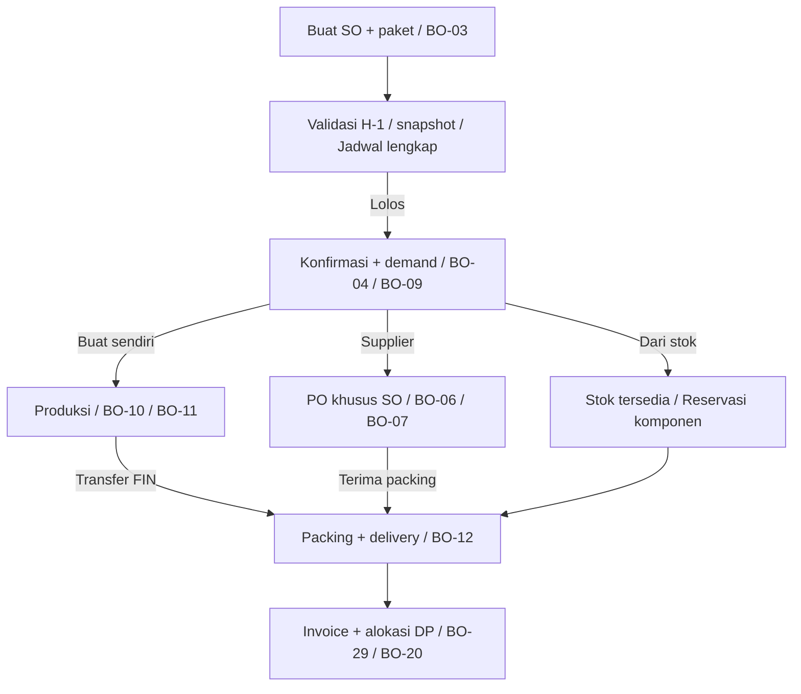
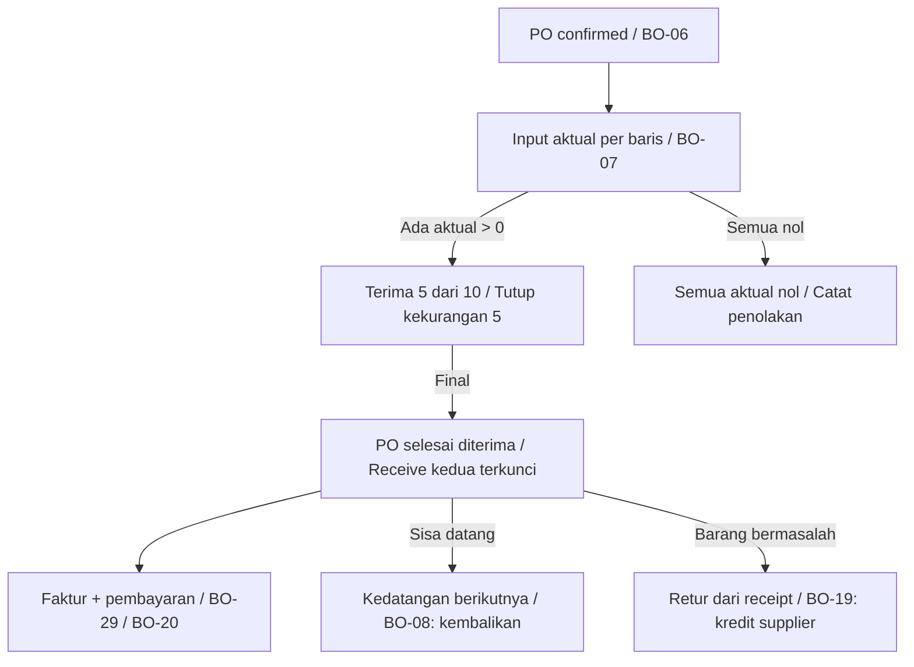
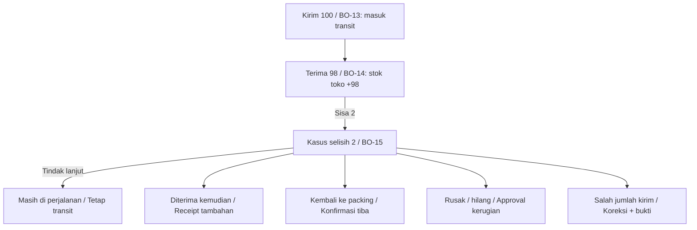
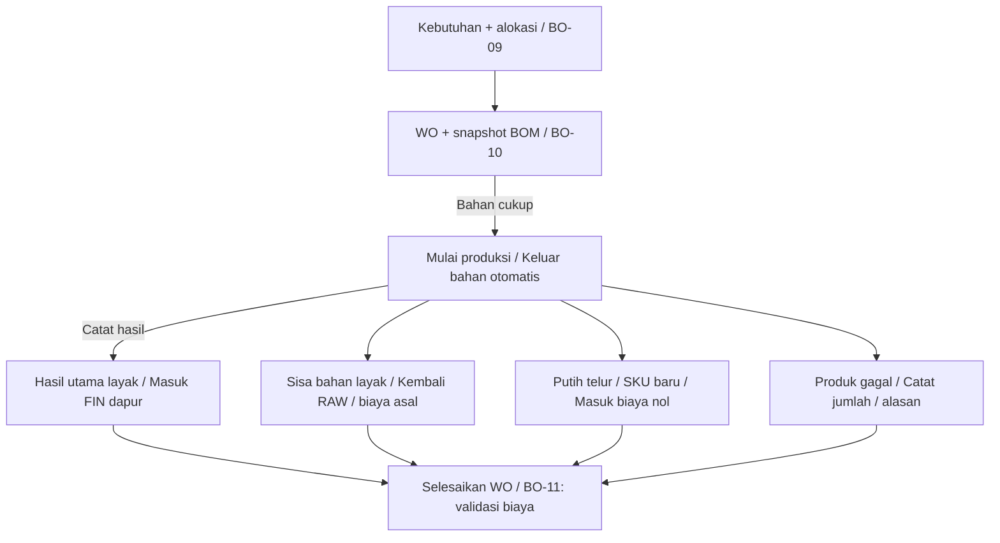
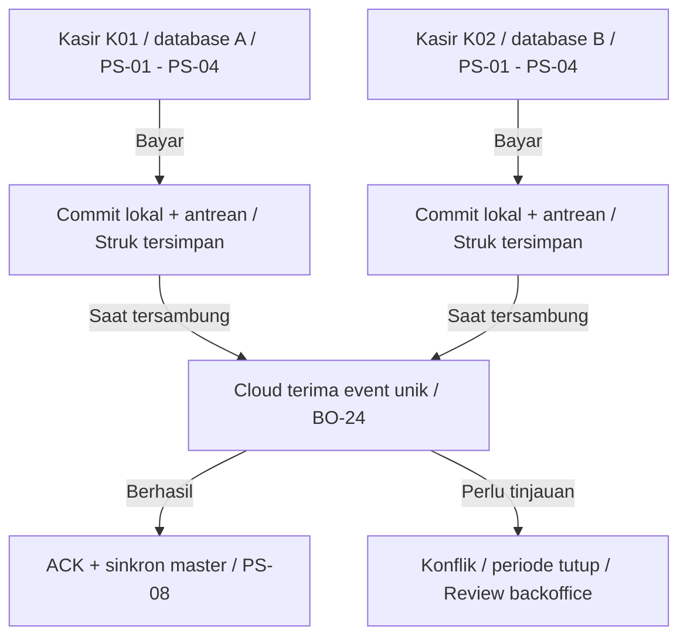
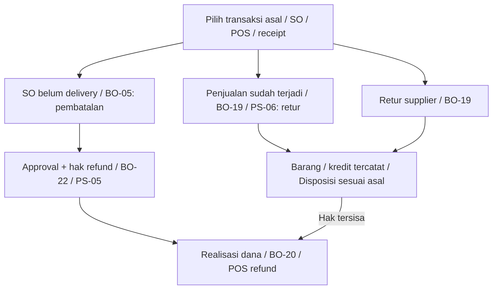

# Alur UI ERP Yussy Akmal v1.0
25 Oktober 2026 | Diagram pendamping desain layar

## F-01 - Pesanan pelanggan sampai terpenuhi
Backoffice mengelola SO, kebutuhan, pengiriman, DP dan pelunasan.

- Setelah WO dibuat, tambahan masuk approval produksi; hanya selisih kebutuhan yang ditambahkan.
- DP boleh diterima sebelum delivery melalui BO-04/20. Saat invoice terbentuk, DP dialokasikan tanpa kas masuk kedua.
- Komponen dibeli tidak masuk WO; seluruh komponen harus tersedia sebelum delivery yang bersangkutan.

## F-02 - PO hanya satu kali penerimaan
Sisa yang belum datang ditutup, bukan dibuat backorder.

- Jumlah aktual tidak melebihi pesanan. Baris nol perlu alasan; satu PO tidak dapat diposting oleh dua petugas sekaligus.
- Barang pada kedatangan berikutnya ditolak tanpa mutasi stok/utang. Bukti penolakan disimpan.
- Retur mengurangi stok/kewajiban yang sah, tetapi tidak membuka PO untuk penerimaan kedua.

## F-03 - Transfer 100, diterima 98
Selisih 2 pcs tetap terlihat sampai diperiksa dan diselesaikan.

- Hanya pilihan masih dalam perjalanan yang tidak menyelesaikan kuantitas transit. Catat PIC dan tenggat pemeriksaan.
- Barang kembali dipindahkan ke packing setelah tiba; rusak/hilang mengurangi transit lewat approval.
- Kesalahan jumlah kirim memulihkan sumber hanya bila barang memang tidak berangkat. Jumlah seluruh resolusi tidak boleh melebihi sisa.

## F-04 - Produksi dan hasil samping
Pemakaian bahan mengikuti resep; hasil aktual dicatat saat selesai.

- Pengeluaran bahan strict non-minus. Kekurangan satu bahan membatalkan start seluruh WO.
- Seluruh biaya telur dibebankan pada produk utama; putih telur punya harga jual terpisah dan dapat dipakai sebagai bahan.
- Empat keluaran adalah input form penyelesaian, diposting atomik saat selesai. Hasil utama nol memerlukan approval kerugian.

## F-05 - POS lokal, dua kasir, satu cloud
Transaksi aman secara lokal; status penerimaan cloud ditampilkan terpisah.

- Tidak mengirim saldo lokal untuk menimpa saldo cloud. Stok dua terminal mungkin berbeda saat offline; POS boleh minus dengan penanda.
- Retry memakai identitas event yang sama. ACK hilang tidak boleh menghasilkan penjualan dan jurnal ganda.
- Antrean tidak dibuang saat restart atau error. Tindakan diskon, batal, dan refund offline memakai persetujuan supervisor yang valid.

## F-06 - Pembatalan, retur, dan refund
Barang, hak kredit, dan uang mempunyai status masing-masing.

- SO batal dengan barang supplier diterima: lepas reservasi, transfer ke toko sebagai owned, utang supplier tetap berlaku.
- Retur POS offline hanya untuk struk lokal tersedia. Struk terminal lain membutuhkan validasi cloud.
- Retur tidak selalu langsung refund; boleh kompensasi kredit sesuai dokumen. Jumlah dan uang dibatasi sisa hak setelah tindakan sebelumnya.
